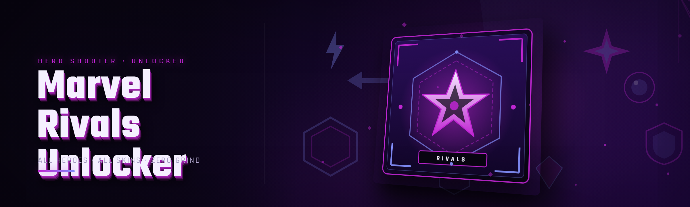

  
  
  

  

  
  
  

---

Marvel Rivals unlocker: aimbot, ESP/wallhack, skin & hero unlocker, injector loader with anti-cheat bypass.

## Overview

Marvel Rivals unlocker: aimbot, ESP/wallhack, skin & hero unlocker, injector loader with anti-cheat bypass.

  

## License

[MIT License](LICENSE)

  

